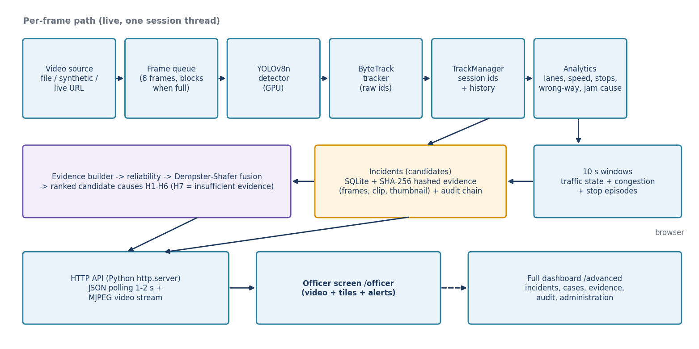
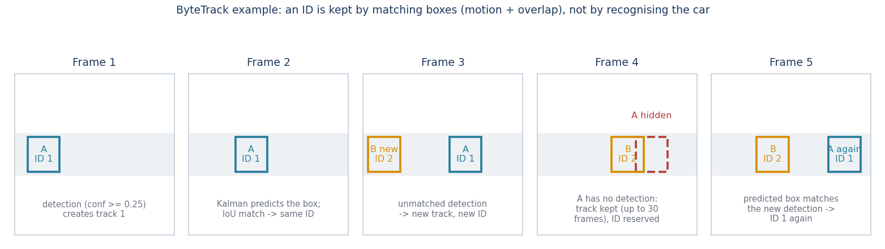
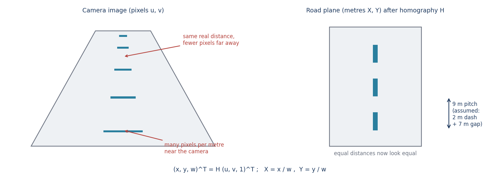

# ANVESH - Presentation and Technical Viva Guide

*Understand, present and defend the project from the basics*

- Project: ANVESH - Vehicle Behaviour Analysis and Traffic Forensics System
- Based on the final repository (branch officer-screen, commit d0ec041), source code, finalization report and benchmark files
- Written for the project presentation / viva; research and demonstration system

> Every number comes from the code, the reports or the benchmark files in this repository. Items that were not measured are marked "not measured" / "not recorded". Worked examples are labelled illustrative.


## 0. Read this first: the questions you could not answer last time

You were asked: *how many frames per second does it process, which model, which algorithm, how are IDs assigned, and why are the ID numbers limited?* Here are short, honest answers. Every later part explains them properly.

**The five answers**

| Question | Short answer you can say out loud |
|---|---|
| **How many frames per second?** | "The video is 25 fps. In our last 20-minute real-time test the system averaged **21.8 fps** and processed all 30,001 frames with none dropped, but it kept up with 25 fps only for the first ~12 minutes of video; after that it fell to 15-21 fps. That test ran on a shared laptop that was probably on battery, so it is not a clean capacity number. With the video pacing removed (fast mode, 150 s) it reached **41.4 fps**." (Section 10) |
| **Which model?** | "**YOLOv8n** (the *nano* size of YOLO version 8, 3.16 million parameters), the **pretrained COCO weights** from Ultralytics. We did **not** train it. We fine-tuned a copy on MIO-TCD for 8 epochs (2.97 h) as an experiment, but it was **not promoted** because it was slightly worse on real CCTV." (Section 4) |
| **Which algorithm?** | "Detection: YOLOv8n. Tracking: **ByteTrack** (Kalman filter + IoU matching + Hungarian assignment). Speed: homography to road metres + least-squares slope over the samples inside the calibrated zone. Congestion: occupancy proxy with hysteresis. Causes: **Dempster-Shafer** evidence fusion that is allowed to say 'insufficient evidence'." |
| **How are IDs assigned?** | "ByteTrack gives each new track the next integer from a counter. ANVESH then gives every track its own **session serial** (`session-t00001`, `t00002`...). It is a *temporary label for one uninterrupted track*, not the vehicle's identity or number plate." (Section 5) |
| **Why are ID numbers 'limited'?** | "They are not capped. The counter just keeps counting (we saw **5,552** track IDs in 20 minutes). Two things make it *look* limited: ByteTrack's ids **restart at 1** after a reset and have **gaps**, and the printed form `t00001` is only a minimum width, not a maximum. Also, a car lost for more than 30 frames (1.2 s) comes back with a **new** ID, so the number of IDs is **not** the number of cars." |

> **How to answer:** Golden rule for the viva: say what is **implemented**, what is **measured**, what is **assumed** and what is **not validated**. Examiners respect a clearly stated limit; they punish a claim you cannot defend.


## 1. The project in plain English


### 1.1 What is ANVESH and what problem does it solve?

**ANVESH** (full title: *Vehicle Behaviour Analysis and Traffic Forensics System*) takes video from a fixed road camera and turns it into **reviewable, evidence-backed incident candidates**: a vehicle stopped in a lane, a traffic jam, a vehicle going the wrong way, a possible collision, and a possible *reason* for a jam. It keeps proof (saved frames and clips with a cryptographic hash) and lets an officer review each case with a tamper-evident audit log.

The problem: a city has far more CCTV cameras than people watching them, and a camera only **records**; it does not tell you *what happened* or *why traffic stopped*. After an incident an officer must find the right camera and time, work out what happened, and keep proof nobody can dispute. That is slow and error-prone.

**Project idea**

| Question | Answer |
|---|---|
| Why is analysing vehicle behaviour important? | Stopped vehicles, wrong-way driving and jams cause crashes and delays; early, evidence-backed alerts help officers act and later explain what happened. |
| Limits of traditional monitoring | Humans watch many screens and miss events; searching hours of video is slow; plain detection counts cars but does not explain causes; evidence is easy to dispute. |
| Our solution | Automatic detection and tracking, measured behaviour (lanes, approximate speed, stops, congestion), candidate causes with honest uncertainty, hashed evidence, and an officer-led review workflow. |
| What is different | Not a new detector. The contribution is the **integration**: (1) candidate-cause reasoning that **abstains** when evidence is weak (Dempster-Shafer with reliability discounting); (2) **evidence integrity** (SHA-256 + hash-chained audit + four-eyes approval); (3) **honesty gates** (no km/h without calibration, simulated scenes labelled, nothing presented as proven). |
| Who benefits / applications | Traffic police control rooms, highway operators, accident investigators, road-safety researchers. Examples: stopped-vehicle alerts, jam analysis, post-incident review. |
| Current limitations | Research/demo system: speed is approximate, congestion is a proxy, no ground-truth validation, one camera per session, not production-ready (Section 13). |


### 1.2 Say it in 30 seconds, 1 minute and 2 minutes

> **30 seconds:** "ANVESH watches a fixed traffic camera, finds events such as stopped vehicles, jams and possible collisions, and saves tamper-proof evidence so an officer can review what happened. It does not claim certainty: everything is a candidate for a human to confirm."

> **1 minute:** "Cameras record but they do not explain. ANVESH runs a YOLO detector and a ByteTrack tracker on the video, turns the tracks into measurements - lanes, approximate speed, stopped vehicles, congestion - and raises incident candidates with saved, hashed evidence. For jams it ranks possible causes using Dempster-Shafer evidence fusion, and it is allowed to answer 'insufficient evidence'. An officer reviews each case in a dashboard with an audit trail. It is a research prototype: we are honest that speed is approximate and nothing is validated against ground truth."

> **2 minutes (what to add):** Add to the minute: "The video is processed live, frame by frame: a decoder feeds a queue, the GPU runs YOLOv8n and ByteTrack, and the officer screen shows the annotated frames as an MJPEG stream while a small JSON feed updates the tiles. Evidence goes into SQLite with a SHA-256 hash and a hash-chained audit log. We tested it with 1,403 automated tests and a 20-minute real-time run. The detector is pretrained; the new work is the reasoning, evidence and workflow around it."


### 1.3 A 5-minute walkthrough

1. **Problem** (30 s): cameras record, they do not explain; evidence is easy to dispute.
2. **Start the demo** (`Start ANVESH Demo.bat`): the officer screen opens; five cards, each labelled REAL VIDEO or SIMULATED.
3. **Click the real motorway video**: the status line shows LIVE, the camera and the session id; boxes and track numbers are drawn on the frames the detector is processing *now*.
4. **Point at the tiles**: lanes, speed (marked approximate), wrong-way, accident, plate ("too small" at 640x360), jam cause.
5. **Pause/Resume/Stop**: the screen says PAUSED / Stopped; the server really ends the session and the stream.
6. **Click 'Test: jam from a breakdown'** (SIMULATED): the jam-cause tile names a *candidate* at the front of the queue and says why.
7. **Open the full dashboard**: incidents with hashed evidence, a case, four-eyes approval, the audit chain.
8. **Close with limits**: approximate speed, proxy congestion, no ground truth, research only.


## 2. Complete system architecture



*ANVESH data flow. Top row: the live per-frame path. Middle: windows, incidents, evidence reasoning. Bottom: API and the two screens.*


### 2.1 Each component: what, why, in, out, who uses it

**Components**

| Component (code) | What it does and why | Input -> Output | Used by |
|---|---|---|---|
| **Frame source** `perception/ingestion.py` | Reads video frames with OpenCV; a recorded file is paced at video speed (`realtime_factor` 1.0). Needed so processing behaves like a live camera. | file / synthetic scene / URL -> `Frame(image, timestamp, index)` | queue |
| **Frame queue** `streaming/queues.py` | Bounded buffer (8 frames, policy *block*): if processing is slower, the reader waits; memory cannot grow. Counts drops and high-water. | frames -> frames | engine |
| **Detector** YOLOv8n | Finds vehicles in one image. | image -> boxes, scores, class ids | tracker |
| **Tracker** ByteTrack | Links boxes across frames so a vehicle keeps an ID. | detections -> boxes with raw track ids | TrackManager |
| **TrackManager** `perception/track_manager.py` | Gives each track a session-scoped serial identity, keeps its history and occlusion state. | raw ids -> `session-t00001` + trajectory | analytics, windows |
| **Analytics** `app/officer.py`, `detectors.py`, `livespeed.py`, `jamcause.py` | Per frame: lane of each vehicle, speed, stopped vehicles, wrong-way, collision candidate, jam-cause candidate, plates. | tracks -> tiles, alerts, incident candidates | API, storage |
| **Windows + traffic state** `streaming/windows.py`, `perception/traffic_state.py` | Every 10 s: vehicle count, flow, occupancy, mean speed, congestion level with hysteresis. | tracks -> `TrafficState` | congestion detector, evidence |
| **Evidence + fusion + ranking** `evidence/`, `fusion/`, `hypotheses/` | Scores hypotheses H1-H6, discounts by camera reliability, combines with Dempster-Shafer, ranks (may abstain). | window state -> ranked candidate causes | incident record |
| **Storage** SQLite (WAL) | Incidents, evidence files with SHA-256, cases, users, audit chain. | incidents -> rows + files | dashboard |
| **API/server** `app/server.py`, `routes.py` | Python standard-library HTTP server; JSON routes and the MJPEG stream. | HTTP requests -> JSON / JPEG stream | browser |
| **Officer screen / dashboard** `app/static/` | Vanilla JavaScript pages: show video, tiles, alerts; cases and evidence. | JSON + stream -> what the officer sees | the officer |


### 2.2 One video, from entry to the final screen

1. You click **Real motorway CCTV**. The page sends `POST /api/v1/cameras/demo-motorway/sessions`. The server checks your role, creates a session row (`SES-...`) and starts **one daemon thread** for it.
2. The thread opens `demo.mp4` with OpenCV and builds the detector + tracker (a warm-up at server start makes the first session faster). Status: *starting* -> *live*.
3. Each frame (640x360, every 40 ms at 25 fps) is decoded and put into the frame queue.
4. The engine takes a frame, runs `model.track()`: YOLOv8n finds vehicles (confidence >= 0.25, five vehicle classes), ByteTrack attaches raw IDs.
5. TrackManager maps raw IDs to session serials and appends the ground point (bottom centre of each box) to each track's history.
6. Analytics use the history: lane polygons, speed (inside the speed zone), stopped vehicles, jam cause... Every 10 s a window closes and the congestion level is updated.
7. The annotated frame (boxes, ids, lanes, banner) is JPEG-encoded into one slot, `last_jpeg`. An incident, if raised, is stored with its frames, clip and SHA-256 hash.
8. The browser shows frames through `` and polls `GET /sessions/{id}/officer` once a second for tiles and alerts.
9. You press Stop: `POST .../stop`; the session thread ends, state becomes *stopped*, the stream closes, the page shows the **Stopped** end card.


## 3. Every technology we used, and why

Versions are from `requirements-lock.txt` / `pyproject.toml` (checked in this repository). **No FastAPI, Flask, React, WebSocket or SSE is used** - say this clearly if asked.

**Technology choices (verified against the repository)**

| Technology (version) | What it is / does | Why we chose it | Alternative and why not | Where used |
|---|---|---|---|---|
| **Python** 3.11.9 | Programming language | Best ecosystem for ML and video; fast to build and test | C++ (faster, much slower to develop) | everything |
| **Ultralytics YOLOv8n** (ultralytics 8.4.132) | Real-time object detector (+ built-in ByteTrack) | Fast on a laptop GPU, simple API, pretrained on COCO, one call does detect+track | Faster R-CNN: two-stage, often more accurate on small objects but usually much slower per frame (not benchmarked by us); SSD: older, weaker | `perception/tracking.py` |
| **PyTorch** 2.13.0+cu130 | Deep-learning engine that runs the network on the GPU (CUDA 13) | Required by Ultralytics; GPU gives ~10-28 ms per frame | TensorFlow/ONNX: would need conversion | under YOLO |
| **ByteTrack** | Tracker that links detections over time | Needs no appearance model, fast, handles low-score boxes | DeepSORT: adds a ReID network, slower; SORT: simpler, more ID switches | inside Ultralytics, config `bytetrack.yaml` |
| **OpenCV** 5.0.0.93 | Video decode, drawing, JPEG encode, `findHomography` | Standard, fast, one library for all image tasks | FFmpeg directly: no drawing / geometry | `ingestion.py`, `officer.py`, `calibration.py` |
| **NumPy** 2.4.6; **lap** 0.5.13 | Arrays; linear-assignment solver used by ByteTrack matching | Required by the stack | SciPy `linear_sum_assignment`: slower here | everywhere; tracker |
| **http.server** (`ThreadingHTTPServer`) | Python's built-in web server, one thread per request | No dependency, easy to audit, enough for a demo; stream and JSON are simple | FastAPI/Flask: nicer routing and async, but extra dependencies and more moving parts | `app/server.py`, `routes.py` |
| **SQLite** (WAL mode, `sqlite3`) | Embedded database | Zero setup, transactions, one file, good for one server | PostgreSQL: needed for many servers / heavy concurrency | `app/db.py` |
| **HTML + CSS + vanilla JavaScript** | The two screens | No build step, small, works under a strict content-security policy | React/Vue: more tooling than a demo needs | `app/static/` |
| **MJPEG** over HTTP | A stream of JPEG images in one response | Works in a plain `` tag, no player code, each frame independent | WebRTC/HLS: smoother, but far more complex | `routes.py` `session_stream` |
| **hashlib** (SHA-256, scrypt) | Evidence hashing; password hashing | In the standard library; scrypt is memory-hard | bcrypt/argon2: extra packages | `evidence.py`, `auth.py` |
| **RapidOCR** 1.4.4 + onnxruntime 1.32.0 | Text recognition (plates) | Light, runs without a second deep-learning stack | EasyOCR: heavier; not connected for incident evidence | `plate_reader.py` |
| **pytest** 9.1.1, **psutil** 7.2.2, Playwright (tools only) | Tests; memory/CPU sampling; browser checks | Standard | - | `tests/`, `demo/tools/` |


## 4. Object detection: YOLO and the model


### 4.1 What detection is, and what YOLO returns

**Classification** says *what is in the picture* (one label). **Object detection** says *what and where*: it draws a **bounding box** around each object and gives a **class** and a **confidence**. **YOLO** (*You Only Look Once*) does this in one pass through a neural network, which is why it is fast enough for video.

For one frame YOLOv8n returns a list like this (illustrative values, real format): box `[x1, y1, x2, y2] = [312, 188, 356, 214]` pixels, **confidence** `0.87` (how sure the network is, 0 to 1), **class id** `2` (= *car* in COCO). ANVESH keeps only vehicle classes: COCO ids **1 bicycle, 2 car, 3 motorcycle, 5 bus, 7 truck**. *Person* (0) is not in the list, so pedestrians are never tracked as vehicles. The next stage (ByteTrack) receives these boxes with their scores.


### 4.2 The exact model

**The model**

| Question | Verified answer |
|---|---|
| Which model? | **YOLOv8n** - Ultralytics YOLO **version 8**, size **n (nano)**: the smallest, fastest variant. File `models/yolov8n.pt`, SHA-256 `f59b3d83...`. Loaded in code as `YOLO("models/yolov8n.pt")`; task `detect`, **80 classes**, **3,157,200 parameters** (counted from the file in this session). |
| Pretrained? | **Yes.** Pretrained by Ultralytics on the **COCO** dataset (80 everyday classes). The base training details (epochs, hours) are **not recorded in this repository**; we did not train it. |
| Did we train it ourselves? | **The default model: no.** We experimented with **fine-tuning (transfer learning)** a copy: `anvesh_mio5_yolov8n_best.pt` - see 4.4. It is **not used** unless `ANVESH_FINETUNED_MODEL` is set. |
| Input size and preprocessing | Ultralytics default `imgsz = 640`: the 640x360 frame is **letterboxed** (resized keeping aspect ratio, padded to a multiple of 32), pixel values scaled to 0-1, sent to the GPU as a tensor. We do not set a custom size. |
| Thresholds | `conf = 0.25` (we pass it). NMS IoU threshold `0.7`, max 300 detections per image (Ultralytics defaults, not changed by us). |
| How unwanted detections are filtered | (1) confidence below 0.25 dropped; (2) `classes=[1,2,3,5,7]` filter; (3) NMS removes duplicate boxes; (4) boxes with zero width/height are ignored by the tracker. |


### 4.3 IoU, confidence threshold and NMS (simple)

$$
\mathrm{IoU}(A,B)=\frac{\mathrm{area}(A\cap B)}{\mathrm{area}(A\cup B)}
$$

*Intersection over Union: 0 = no overlap, 1 = identical boxes*

- **Confidence threshold**: ignore a box if the network is less than 25 % sure. Lower = more detections and more false alarms; higher = fewer boxes and more misses.
- **NMS (Non-Maximum Suppression)**: the network proposes many overlapping boxes for one car. Keep the highest-scoring box, delete any other box of the same class whose IoU with it is above 0.7, repeat.
- Example: boxes A (score 0.9) and B (score 0.6) on one car with IoU 0.8: B is removed. Two different cars with IoU 0.1 both stay.


### 4.4 Training, pretraining, fine-tuning, inference, validation

**Vocabulary**

| Term | Meaning |
|---|---|
| Training from scratch | Learn all weights from random numbers on a big labelled dataset (days/weeks). **We did not do this.** |
| Pretraining | The general training someone else did (Ultralytics on COCO). Our `yolov8n.pt`. |
| Fine-tuning / transfer learning | Start from pretrained weights and continue training on a *new* dataset so it fits a new task. **We did this as an experiment.** |
| Validation | Measuring the model on labelled images *not used to learn*, to see how good it is (and to pick the best checkpoint). |
| Inference | Using the finished model on new images. **This is what ANVESH does at run time.** |

**What we actually trained**

| Fact (from `docs/ANVESH_MODEL_TRAINING_REPORT.md` and `args.yaml`) | Value |
|---|---|
| Run / dataset | `anvesh_mio5_v1b`; **MIO-TCD** localization converted to 6 classes: **88,270 train / 10,865 val / 10,865 test images** |
| Epochs / time / hardware | **8 of 8 epochs, 2.97 hours**; GPU device `0` (the RTX 3050 6GB Laptop GPU of this machine) |
| Optimiser / learning rate / batch | **AdamW**, `lr0 = 0.001`, `lrf = 0.01`, momentum 0.937, weight decay 0.0005, batch 16, `imgsz` 640, mixed precision, early-stop patience 4 |
| Loss | Ultralytics detection loss: box (CIoU), classification (binary cross-entropy) and distribution-focal loss - logged as `box_loss`, `cls_loss`, `dfl_loss` in `results.csv`. *Iterations* are not recorded separately: 88,270 images / batch 16 is about 5,517 per epoch (derived). |
| Result on its own data | MIO-TCD held-out **test mAP@50: 0.870 (fine-tuned) vs 0.215 (pretrained)**; test evaluated once. Training was not converged (val mAP still rising at epoch 8). |
| Result on real CCTV | CityFlow S02 (no class labels): pooled **recall 0.718 fine-tuned vs 0.748 pretrained** -> **not promoted**, default stays the pretrained model. |
| Plate detector (separate model) | YOLOv8n fine-tuned **12 epochs** on a Vietnamese plate dataset (6,176 / 1,765 / 882 images); final validation mAP@50 **0.98** on that dataset only; licence chain unverified; not validated on CCTV. |

> **Your answer:** **"Did you train this model yourself, or use a pretrained one? Why?"** - "The detector in ANVESH is the **pretrained YOLOv8n COCO model**. Training a detector from scratch needs a large labelled dataset and weeks of GPU time, and our contribution is the reasoning built on top of detection. We did try transfer learning: we fine-tuned a copy on MIO-TCD for 8 epochs (about 3 hours on a laptop GPU). It scored much higher on MIO-TCD (mAP50 0.870 vs 0.215) but was slightly worse on real CCTV footage (recall 0.718 vs 0.748), so we did not promote it and we say so. Detection accuracy on our own demo video is **not measured** because it has no labels."


## 5. Tracking and vehicle IDs


### 5.1 Detection vs tracking

Detection works on **one frame at a time** and has no memory: the same car in frame 1 and frame 2 is just two unrelated boxes. **Tracking** adds memory: it decides *which box in this frame is the same vehicle as which box in the last frame* and gives it a consistent number. Without tracking you cannot measure speed, count a vehicle once, or notice that it stopped.


### 5.2 ByteTrack, step by step (as in the installed Ultralytics 8.4.132 code)

1. **Predict.** Each existing track has a **Kalman filter** (state: centre x, y, aspect ratio, height, and their velocities). It predicts where the box should be in this frame.
2. **Split detections** by score: *high* (>= 0.25) and *low* (between 0.1 and 0.25). *Note: ANVESH passes `conf=0.25` to YOLO, so low-score boxes never reach the tracker - ByteTrack's second stage is effectively unused (we measured conf 0.10 and did not adopt it: it inflated the congestion proxy).*
3. **First association.** Cost = 1 - IoU (blended with the detection score) between every predicted box and every high-score detection. An optimal assignment solver (`lap`, Jonker-Volgenant - same result as the Hungarian algorithm) finds the cheapest one-to-one pairing; pairs with cost above `match_thresh = 0.8` are rejected (roughly IoU below ~0.2).
4. **Second association** (IoU only, threshold 0.5): leftover tracks are matched to low-score boxes - this is ByteTrack's idea, to rescue partly hidden cars.
5. **Update or lose.** Matched tracks are updated. Unmatched tracks become **lost** and are kept for `track_buffer = 30` frames (**1.2 s at 25 fps**); after that they are deleted.
6. **New tracks.** A detection with no track and score >= `new_track_thresh = 0.25` starts a new *tentative* track; it is confirmed when it is matched again in the next frame. Each new track takes the **next integer** from a global counter.



*The 5-frame example: a track is kept by matching boxes; a hidden vehicle's track is kept for up to 30 frames.*


### 5.3 What happens in the five-frame example

**Tracker walk-through (illustrative scene, real algorithm)**

| Frame | What the tracker does |
|---|---|
| 1 | Car A detected (conf 0.8). No tracks exist, so a new track is created: **ID 1**. |
| 2 | A has moved. The Kalman filter predicted its new box; IoU with the detection is high -> **same ID 1**. |
| 3 | Car B enters. No track overlaps it -> **new track, ID 2**. A keeps ID 1. |
| 4 | A passes behind B: no detection for A. Its track becomes *lost* but is **kept** (up to 30 frames) and keeps being predicted. B keeps ID 2. *Risk:* if B's box overlaps A's predicted box, the tracker could give A's ID to B (an **ID switch**). |
| 5 | A reappears where the Kalman filter predicted it -> matched -> **ID 1 again**. If it had been hidden **more than 30 frames**, its track would be gone and it would get a **new ID (3)**. |


### 5.4 How ANVESH turns tracker IDs into session identities

A **raw ByteTrack ID** is just the next integer from a counter inside the library. It restarts at 1 after a reset, may be re-emitted for a revived track, and has **gaps** (ids given to tentative tracks that never got confirmed). It is not safe to store as a vehicle identity. So `TrackManager` creates its own key:

```
identity key = (camera_id, session_id, serial)
printed as        SES-ABC123-t00001, SES-ABC123-t00002, ...
serial           = per-session counter, +1 per new track, never reused
raw ByteTrack id = kept only for audit
```

- `t00001` uses a *minimum width* of 5 digits (`:05d`); `t123456` is valid. **There is no upper limit** (Python integers). In the 20-minute run the session created **5,552** tracks.
- If a raw ID comes back after its state was closed, it opens a **new** serial - it can never overwrite an old one. A stream reconnect or tracker reset starts a **new session**.
- An identity is a **tracklet** (one uninterrupted run of the tracker). The same physical car can have several identities (hidden > 1.2 s, far-field flicker, reconnect), and ANVESH never merges them. **5,552 IDs in 20 minutes is not 5,552 cars.** The screen therefore says *"tracks this session - not unique vehicles"*.
- Concurrent "vehicles in view" is a different number: tracks currently present.

**Four different things - do not mix them up**

| Term | What it is | Lifetime |
|---|---|---|
| **Detection** (no ID) | One box in one frame from YOLO | one frame |
| **Raw track ID / tracker ID** | ByteTrack's integer for a box-stream | until reset; may have gaps; can be revived |
| **Session track ID** (`SES-...-t00001`) | ANVESH's identity for a tracklet | one session of one camera |
| **Vehicle registration (plate) number** | The real-world identity of a vehicle, e.g. `MH12AB1234` | permanent; ANVESH never derives it from a track ID - a plate is a separate, officer-verified record |


### 5.5 Can IDs switch or be confused?

**Yes.** ByteTrack uses only motion and box overlap, no appearance. IDs can switch when vehicles overlap or cross, fragment when a vehicle is hidden for more than 30 frames, or change class label when the detector flickers. On the CityFlow ground truth the raw tracker scored IDF1 >= 0.209 (a lower bound) with 42 ID switches on one camera (historical, `M-A_FOUNDATION_REPORT`). We reduced harm by using time-based occlusion handling and by not merging tracklets, but we did **not** improve tracking accuracy itself.


## 6. Speed estimation: formulas and mathematics


### 6.1 Why pixels are not metres

A box moving 10 pixels does **not** mean a fixed distance. A camera looks along the road, so near objects look big and far objects look small (**perspective distortion**). From our fitted calibration, one pixel of vertical movement is about **0.42 m at image row 225 (far)** but only about **0.10 m at row 320 (near)**. The same 10-pixel move is 4.2 m far away and 1.0 m near the camera. So we first convert image points into **road-plane metres**.



*A homography maps the camera's view of the (flat) road onto a top-down plane in metres.*


### 6.2 The method we actually use

1. **Ground point.** For each tracked box use the **bottom centre**: `(u, v) = ((x1 + x2) / 2, y2)`. The box centre floats above the road; the bottom edge is where the tyres touch the ground. Boxes touching the frame edge are discarded (a clipped bottom edge is not the ground).
2. **Homography.** A 3x3 matrix `H`, fitted once per camera by `cv2.findHomography` (least squares) from 10 known road points (lane-marking dashes), maps pixels to metres.
3. **Window.** Take the track's latest ground points **inside the calibrated speed zone only** (up to 1.6 s back; no time gap above 0.3 s, no clipped boxes, no impossible jump). Needs at least **8 samples** spanning at least **0.4 s**. At motorway speed the zone is only ~20 m long, so a fast vehicle gives a window of about 0.5-0.7 s (13-17 samples).
4. **Least-squares slope.** Fit a straight line of position against time for each axis; isolated outlier samples (more than 3 robust sigmas, at least 0.25 m, from the line) are removed and the fit repeated. The slopes `vx, vy` are the velocity in m/s.
5. **Convert** to km/h. **No extra smoothing** (the fit already averages; extra smoothing would hide real braking). If the error band is wider than 10 km/h the number is **withheld** ('too imprecise').

$$
(x,\,y,\,w)^{T}=H\,(u,\,v,\,1)^{T},\qquad X=\frac{x}{w},\quad Y=\frac{y}{w}
$$

*Pixel (u, v) to road metres (X, Y)*

$$
v_X=\frac{\sum_i (t_i-\bar t)\,X_i}{\sum_i (t_i-\bar t)^2},\qquad v_Y\ \mathrm{the\ same\ with}\ Y_i
$$

*Least-squares slope over the window (m/s)*

$$
\mathrm{speed}_{km/h}=3.6\,\sqrt{v_X^{2}+v_Y^{2}},\qquad \pm\left(2\,\frac{\mathrm{rms}}{\sqrt{\sum (t_i-\bar t)^2}}\cdot 3.6+1\right)
$$

*Speed and the displayed error band (about 95 % of the slope uncertainty + 1 km/h)*

Symbols: `u, v` pixel column/row; `H` the 3x3 calibration matrix; `X, Y` metres on the road; `t_i` the timestamp of sample *i*; `bar t` the mean time; `3.6` converts m/s to km/h (1 m/s = 3600 m / 1000 m per h); `rms` the root-mean-square distance of the points from the fitted line (a noise measure).


### 6.3 Worked example (illustrative numbers, not a recording)

A car's ground points projected to the road at t = 0, 0.1, 0.2, 0.3, 0.4 s give Y = 6.0, 8.5, 11.0, 13.5, 16.0 m (X constant). Slope: (16.0 - 6.0) / 0.4 = **25 m/s**. Speed = 25 x 3.6 = **90 km/h**. Using the pixel movement instead of `H` would give a wrong answer that changes with distance from the camera.


### 6.4 Why it is approximate, and when it fails

**Assumptions and failure cases**

| Reason | Effect |
|---|---|
| The **scale is assumed**: UK lane-marking standard (2 m dash + 7 m gap = 9 m pitch, lane width 3.65 m). The road was not surveyed and its identity is unverified. | If the real pitch were 6 m, every speed would be wrong by the same factor (about 63 instead of 95 km/h). Plausibly **+/-10 % or more**, **not** included in the displayed +/- band. A homography cannot detect a uniform scale error. |
| Calibration fit: RMSE **0.094 m** (10 points); hold-out dash end points within **0.43 m** | Shows the geometry is self-consistent, not that the metric scale is right. |
| Flat-road assumption, one homography, near-field **speed zone** only (rows >= 225) | Curves, crests, far field: unreliable; speed is shown only inside the magenta zone. |
| Box jitter (bottom edge moves a few pixels) | Averaged by the least-squares fit; isolated outliers are removed; tracks with rms > 2.5 m or > 250 km/h are rejected; an error band above 10 km/h is withheld; clipped or short tracks give no number. |
| Camera moved / different angle | `H` is wrong -> all speeds wrong. Re-calibration is needed. No automatic detection of this. |

> **Be honest:** **Validation:** there is **no ground-truth speed** (no radar, GPS or surveyed distance), so the **absolute scale is not verified**. What *was* verified (speed audit, `docs/ANVESH_SPEED_AUDIT_FINDINGS.md`): timing is exact (constant 25.000 fps, video timestamps only); the formula and units are right; and a real defect was found and fixed - the fit window used to reach back into the *extrapolated* far field (local speed read 1.10x at rows 195-225 and 1.22x at rows 170-195 versus 1.0 in the calibrated rows), inflating displayed speeds by ~13-17 %. After the fix the median of 689 estimates is 94.9 km/h (was 111.4), the share above 112.7 km/h fell from 47 % to 6 %, and the `truck` class median is 88 km/h (UK HGV limiter ~90 km/h - plausibility, not validation). **FPS does not change the formula**: it uses real timestamps. Without a validated calibration the system shows **no km/h at all**.


## 7. Congestion and behaviour analysis


### 7.1 Congestion: what is actually measured

Every **10 s window** is summarised from the tracks present in it:

$$
\mathrm{occupancy}=\min\left(1,\ \frac{\mathrm{mean\ concurrency}}{20}\right)
$$

*Occupancy proxy; 20 = assumed capacity (max_capacity_vehicles)*

- **mean concurrency** = average number of vehicles present at the same time in the window; **flow** = vehicles / window seconds; **mean speed** only from tracks whose speed was measured on a validated camera.
- **Rule (calibrated camera):** low pressure if mean speed >= 8 m/s (29 km/h) and occupancy < 0.6; high if mean speed <= 3 m/s (11 km/h) **or** occupancy >= 0.6; else medium. **Without speed:** occupancy >= 0.6 high, <= 0.3 low, else medium.
- **Hysteresis** (a small state machine) turns window values into FREE_FLOW / BUILDING / CONGESTED / DISSIPATING so one window cannot flip the state. An episode closes only after 30 s of free flow (60 s in the demo) so one stop-and-go jam is one incident.

> **Honest status:** **This is a proxy, not verified congestion.** Capacity 20 is assumed; one count covers six lanes; on the demo clip it can say *congested* while vehicles move at 55-65 km/h (dense but flowing). Pedestrians are not counted (only 5 vehicle classes are tracked). We have no labelled congestion data.


### 7.2 Other behaviours (all implemented, mostly unvalidated on real events)

**Behaviour detectors**

| Behaviour | Rule actually coded | Status |
|---|---|---|
| **Stopped vehicle** | Stays within **0.75 m** (metric) or **7.5 px** (image) of its recent mean for a **3 s** dwell, i.e. slower than 0.5 m/s. Severity is lowered if it stops inside a queue (>= 3 stationary vehicles or congestion level BUILDING/CONGESTED). | real footage: 14 stops in 20 min, reviewed by eye, not scored |
| **Wrong-way** | Net ground-point direction in a configured zone opposes the zone's expected direction for >= a minimum duration; duplicates within 3 s / 120 px suppressed as the same vehicle. | only on SIMULATED scenes; needs configured zones |
| **Possible collision** | Two vehicles **moving and closing**, boxes overlap (IoU >= 0.10) for >= 1 s, then **both stationary within 2.5 s**; rejected if >= 60 % of >= 4 neighbours are also stopped (a queue/standstill). | heuristic; **no real collision exists in our footage** |
| **Jam-cause candidate** | Stopped vehicles close together form a queue; the vehicle at the downstream front is the candidate; reports whether it stopped first, how many queued behind, and a Spearman order correlation; rated *likely* or *possible*. | candidate only; does not know *why* it stopped |
| Over-speed / braking / lane change | Use the calibrated speed inside the speed zone (demo limit 112.7 km/h = 70 mph). | no real event in the footage |

**Traffic signals:** ANVESH does **not** read signals from video. A queue at a red light can look like congestion; the signal state is a configured/manual/external input used for red-light detection and the H6 hypothesis, not an automatic distinction.


## 8. Evidence fusion and hypothesis ranking

**The problem:** when traffic jams, *why*? A stopped vehicle? A crash? Heavy demand? One measurement is rarely enough and may be wrong. **Evidence fusion** combines several pieces of evidence while keeping track of how unsure we are. **Dempster-Shafer (DS) theory** does this with *belief masses* instead of probabilities, and has an explicit place for 'I don't know'.

**The closed set H1-H7**

| Hypothesis | Meaning (from `hypotheses/cause_model.py`) |
|---|---|
| H1 | downstream bottleneck (congestion with no obstruction found) |
| H2 | stopped / disabled vehicle |
| H3 | collision-like obstruction |
| H4 | lane blockage, non-incident |
| H5 | upstream demand surge |
| H6 | signal / intersection restriction |
| H7 | **insufficient evidence** - not a cause: it is the leftover ignorance mass |


### 8.1 How it works, step by step

1. **Evidence.** For each window the evidence builder scores each hypothesis between 0 and 1 from measured facts. Example rules: H1 = (0.5 + 0.5 x occupancy) x coverage if congested and no stopped vehicle; H2 = 0.8 if exactly one vehicle is stopped, 0.2 (contradicting) if two or more. A hypothesis that cannot be tested gets *no* support.
2. **Mass assignment.** Supporting scores become masses on single hypotheses; if they add to more than 1 they are scaled; the **rest is ignorance** `m(Theta)`. No evidence anywhere = pure ignorance = *insufficient evidence*.
3. **Reliability discounting.** A camera's reliability `r` (0-1; weights 0.25 each for observation count, tracking continuity, calibration, temporal coverage, times a completeness factor) shrinks its claims:
4. **Combine two cameras** with Dempster's rule, blended with a conservative fallback when both suffer the same condition (fog, glare).
5. **Belief / plausibility and rank.** Rank by belief, then plausibility, then id; outcome is RANKED, HIGH_CONFLICT or INSUFFICIENT_EVIDENCE.

$$
m'(H_k)=r\,m(H_k),\qquad m'(\Theta)=1-r\left(1-m(\Theta)\right)
$$

*Shafer discounting: less reliable camera -> more mass moves to ignorance*

$$
K=\sum_{p\neq q} m_1(H_p)\,m_2(H_q)
$$

*Dempster's rule, step 1: conflict K = mass the two sources put on different hypotheses*

$$
m(H_k)=\frac{m_1(H_k)\,m_2(H_k)+m_1(H_k)\,m_2(\Theta)+m_1(\Theta)\,m_2(H_k)}{1-K}
$$

*Step 2: combined mass of hypothesis k (agreement, or one source being unsure)*

$$
m(\Theta)=\frac{m_1(\Theta)\,m_2(\Theta)}{1-K}
$$

*Step 3: remaining ignorance (both sources unsure)*

$$
\mathrm{Bel}(H_k)=m(H_k),\qquad \mathrm{Pl}(H_k)=m(H_k)+m(\Theta)
$$

*Belief (proven-by-evidence) and plausibility (not ruled out) on this singleton frame*

**Symbols:** `m1, m2` the two cameras' mass functions; `H_k` hypothesis k; `Theta` the whole set = ignorance; `K` the **conflict** (mass the two cameras put on *different* hypotheses); dividing by `1 - K` renormalises. If `1 - K` is almost 0 (total conflict) the code refuses to divide and returns pure ignorance, so conflict stays visible and nothing becomes NaN. With two cameras sharing a degradation the result is blended: `lambda x DS + (1 - lambda) x element-wise-max`, lambda = 0.4.


### 8.2 Worked example (illustrative numbers)

Camera 1: `m(H1) = 0.6`, `m(Theta) = 0.4`. Camera 2: `m(H1) = 0.3`, `m(H2) = 0.5`, `m(Theta) = 0.2`. Conflict `K = 0.6 x 0.5 = 0.30`, so `1 - K = 0.70`. Then `m(H1) = (0.18 + 0.12 + 0.12) / 0.7 = 0.60`, `m(H2) = (0 + 0 + 0.4 x 0.5) / 0.7 = 0.286`, `m(Theta) = 0.08 / 0.7 = 0.114` (sum 1.0). **Bel(H1) = 0.60, Pl(H1) = 0.714**: H1 ranks first, but 0.114 stays as 'unknown'. *Discounting check:* r = 0.8 turns `m(H1) = 0.6` into 0.48 and `m(Theta) = 0.4` into 1 - 0.8 x 0.6 = 0.52.

> **Limits:** **Ranking is not proof.** The top hypothesis is only the best supported among those that *could be tested*. Belief is a DS quantity, **not a probability** (the code never prints a percentage). The scores (0.8, 0.5 + 0.5 x occupancy, ...) are **hand-set heuristics, not learned or calibrated**. **Cross-camera fusion is implemented and unit-tested, but the running application uses one camera per session**, so the shipped product uses the single-camera discounted path; on image-space or uncalibrated cameras the honest result is `insufficient_evidence`. A cause can be *established* only by an authorised officer with a written basis.


## 9. Backend, frontend and live video


### 9.1 Start -> video on screen

1. Button click -> `fetch` `POST /api/v1/cameras/{id}/sessions` (headers `X-Requested-With`; cookie session; role must have `session.control`). Server answers **202** with `{session_id, state: starting}`; refuses a second active session on the same camera.
2. The page calls `attach()`: sets `` and starts polling `GET /sessions/{id}/officer` every **1 s**.
3. The session thread decodes frames, runs the pipeline (Section 2) and keeps the latest annotated JPEG in **one slot** (`last_jpeg`).
4. The stream handler (one HTTP thread per viewer) checks the slot every **80 ms** and writes each *new* JPEG as a multipart part. The JSON poll returns tiles, alerts, state, progress.


### 9.2 MJPEG in one paragraph

**MJPEG = Motion JPEG.** The server sends one long HTTP response of type `multipart/x-mixed-replace; boundary=frame`; each part is a complete JPEG (`--frame`, `Content-Type: image/jpeg`, `Content-Length`, bytes). The browser replaces the image in an `` tag every time a part arrives. It is **not** a video file: there is no seeking and no inter-frame compression (so it uses more bandwidth than H.264), but it needs no player, any single frame is viewable, and it is trivial to implement - ideal for a demonstration. Because there is only one slot, a slow browser skips frames; it can never make the server buffer without limit.


### 9.3 Sessions, pause, stop, isolation, errors

**Lifecycle and reliability**

| Topic | How it works (verified in code/tests) |
|---|---|
| States | starting, connecting, live, paused, reconnecting, stalled, completed, stopped, failed, interrupted. Terminal: stopped, completed, failed, interrupted. |
| Pause / resume | Only **recorded files** can pause (`source.pause()`); live sources refuse. The screen shows PAUSED and a message. |
| Stop | `POST .../stop` sets a stop flag, closes the source, joins the thread; state `stopped`; the stream ends ~2 s later. |
| Isolation | Every session has its own id, thread, track manager and `last_jpeg`; the stream is looked up by session id (tested with two sessions). The officer screen also stops other running sources before starting a new one, and starts are **serialised** (fix for a race found in testing). |
| Errors | Detector/engine exceptions are recorded in the session's `errors`; the state becomes **failed** and the screen shows the first error. A stalled/lost live source goes to *reconnecting* with backoff and starts a **new identity session**. |
| Client disconnect | A closed tab raises BrokenPipe/ConnectionReset in the stream handler; it returns and the thread is freed (tested with 5 abrupt disconnects). The processing session keeps running. |
| Stream reconnection | If the `` connection breaks while the session is still running, the page reconnects up to **3 times**, 1.5 s apart. |
| Stale data | A poll answer for a session that is no longer selected is **dropped**; the page never mixes sessions. |
| Security | scrypt passwords, hashed session tokens, lockout, CSRF header, role-based permissions, four-eyes approval, SHA-256 evidence verification via a *separate* verify route, hash-chained audit log, one-click demo sign-in only on loopback. |


## 10. Performance, FPS and latency

Source video: 640x360 at **25 fps** = one frame every **40 ms**. To keep real time the system must process a frame in under 40 ms **on average**. Hardware: **NVIDIA RTX 3050 6GB Laptop GPU, Intel Core i5-13450HX (10 cores / 16 threads), 15.7 GB RAM, Windows 11**; the GPU is used for detection (CUDA).

**Verified benchmark (docs/benchmarks/, finalization report)**

| Measure (20-minute real-time run, Session 9) | Value | Meaning |
|---|---|---|
| Frames received / processed / dropped | 30,001 / 30,001 / **0** | the frame queue *blocks* when full, so nothing is thrown away; the session just lags |
| Wall time for 1,200 s of video | **1,377.9 s** | it ran 15 % slower than real time overall |
| Average processing FPS | **21.77** | frames processed / wall seconds (source = 25) |
| Real time kept? | first ~740 s at 25.0 fps, then 15-21 fps | after ~800 s the queue stayed full (8/8) |
| Frame-processing latency p50 / p95 / p99 | 34.9 / 71.7 / 105.6 ms (mean 38.8) | time the engine spends on one frame: windowing + detect/track + callbacks (incl. drawing and JPEG) |
| detect + track p50 / p95 | 28.1 / 52.4 ms | the GPU model call |
| End-to-end p50 / p95 | 43.3 / 663.9 ms | decoded frame -> processed, **including waiting in the queue**; excludes the browser |
| Memory (RSS) | up to 1,745 MB; first -> last quarter +1.5 % | no leak seen |
| GPU / CPU | GPU util mean 27 % (max sampled 70 %); server CPU mean 103 % of one core | 10 s samples; GPU memory reading (133-177 MiB) looks low and was **not cross-checked** |
| Fast mode (150 s, no pacing) | **41.4 fps**, p50 13.4 / p95 32.0 ms | capacity test at that moment; **not** real time |

**Terms**

| Term | Simple meaning |
|---|---|
| Input FPS | How fast the video is *recorded* (25). |
| Processing FPS | How many frames we *finish* per second of wall time. |
| Real-time throughput | Processing FPS >= input FPS, so the system never falls behind. |
| Latency | How long **one frame** takes from start to finish. FPS and latency differ: you can process 25 frames/s, each taking 200 ms, if frames overlap. |
| p50 / p95 | 50 % / 95 % of frames were faster than this. p95 = 71.7 ms means 1 frame in 20 took longer; the **tail** is what makes a mean of 38.8 ms (close to the 40 ms budget) fall behind. |
| Queue wait | Time a decoded frame waits because the processor is busy; it is part of end-to-end latency. |

> **Honest benchmark answer:** **Defend it like this:** "We measured all 30,001 frames with none dropped, 21.8 fps average, 1.7 GB peak memory. We did **not** keep 25 fps for the whole video: after about 12 minutes it fell behind. The laptop was shared and probably on battery, so the cause is **not established** and this is not a clean capacity figure. The earlier 24.89 fps result (Session 7) was **not reproduced**. A large video is processed at the same per-frame cost; only a longer run time." A repeat on a plugged-in, idle machine is still to be done.


## 11. What changed since the previous presentation (2 November)

Sources: Git history (`a74a400` 14 Nov; `629242d`, `976e4fd`, `dfb4046`, `6ba8786` 15 Nov Session 8; `d0ec041` 15 Nov Session 9), `docs/ANVESH_SESSION8_REPORT.md`, `docs/ANVESH_FINALIZATION_REPORT.md`. The 2 November state was the full dashboard (`/advanced`) at git `b6d5ecd` plus an **uncommitted** working tree (sessions 3-7); everything is now committed and pushed.

**Earlier vs current**

| Earlier version (2 Nov) | Current version | Improvement |
|---|---|---|
| Only the full dashboard (21-step demo) | **Officer screen** `/officer`: one click starts a real session; 6 tiles (lanes, speed, wrong-way, accident, plate, jam cause) and an alert list | Simple, video-first, faster to demo |
| No cause hint for a jam | **Jam-cause candidate** (front-of-queue vehicle, stopped-first, order correlation) | Explains *why*, always worded as candidate |
| Plates entered by hand only | Live **plate reader** (YOLOv8n plate detector + RapidOCR), real footage only, >= 110 px vehicles | Added; unvalidated on CCTV; silent on the 640x360 demo |
| Wrong-way / accident shown only via the old simulated cameras | Three scripted scenes (jam, wrong-way, accident) labelled **SIMULATED** | Honest demonstration of detectors real footage never triggers |
| State not obvious on the live page | **Status line** (LIVE / PAUSED / STOPPED, camera, session id, recorded/SIMULATED); distinct *Paused* / *Stopped* messages | Clear state; Stop no longer says 'Finished' |
| Slow reply could overwrite a newer screen; stream could freeze | Stale-poll guard; stream **reconnect** (3 tries); starts **serialised** (found by the browser lifecycle test: two sessions could stay running) | Session isolation and reliability |
| Server printed tracebacks for closed tabs; no stream tests | Quiet disconnect handling; **5 MJPEG stream tests** over a real socket | Verified stream termination, ordering, isolation, thread release |
| `/advanced` text said no plate detector exists | Text corrected | Documentation accuracy |
| 1,381 tests; Session 7 benchmark only (24.89 fps) | **1,403 tests**; new 20-minute real-time measurement with CPU/GPU/memory sampling; fast mode kept separate | Honest, reproducible measurements (and a finding: real time was not kept to the end) |
| Work only on disk (not committed) | 31 commits, pushed to GitHub branch `officer-screen`; `.gitignore` keeps unlicensed material out | Reproducible, shareable |
| Handbook 20 chapters | Handbook 22 chapters (officer screen, analytical validity, performance and testing) and a new officer-screen section in the panel guide | Up-to-date documentation |

> **Your answer:** **"What have you improved since your previous presentation?"** - "Mainly usability, reliability and honesty. We added a one-screen officer view that starts a real session with one click and shows the processed video with live state, a jam-cause candidate and a plate reader. We found and fixed real bugs: a late reply could overwrite the screen, the video stream could freeze after a drop, and quick source switching could leave two sessions running. We added stream and lifecycle tests - 1,403 tests now - and ran a 20-minute real-time benchmark, which showed we do not keep 25 fps for the whole video on this laptop; we report that rather than hide it. Everything is committed and on GitHub."


## 12. Testing and reliability

**Kinds of tests**

| Kind | What it is | Example in ANVESH |
|---|---|---|
| **Unit test** | Tests one small function/module alone | IoU / homography / DS combination / speed slope (`tests/world`, `tests/fusion`, `tests/evidence`) |
| **Integration test** | Several modules together | streaming engine + windows + identity (`tests/streaming`) |
| **End-to-end test** | Whole path through the real pipeline | scripted scene -> detectors -> incident -> evidence -> hash verify (`test_session_synthetic.py`); browser lifecycle with real Chrome + real `demo.mp4` (`demo/tools/ui_lifecycle.py`, 12 checks) |
| **Regression test** | Locks a fixed bug so it cannot return | stop-episode late closure, stale poll, the MJPEG tests, queue-vs-collision gates |

**Final verified count: 1,403 tests passed** (run in nine groups: 38 + 110 + 109 + 99 + 306 + 193 + 132 + 229 + 187). One timing-bounded ingestion test failed once when the machine was slow and passed on rerun - we report that. Streaming is tested over a real socket (frames whole and in order, stream ends when the session stops, two sessions never share frames, handler threads freed after 5 abrupt disconnects, 404/401). Pause/resume/stop and a closed browser are exercised by the browser lifecycle script.

> **What the count does not mean:** **A passing suite does not prove the speeds, congestion levels or causes are accurate.** It proves the code does what we *specified*, on synthetic scenes and scripted trackers. Accuracy needs ground truth, which we do not have for these outputs. The real detector is exercised by the benchmark and browser checks, not by unit tests.


## 13. Limitations and future scope

**Honest limitations vs future work**

| Area | Limitation (current) | Needed / future (not done) |
|---|---|---|
| Detection | Pretrained COCO model; accuracy on our footage **not measured**; small far vehicles (median box 28 px) missed/flicker; no auto-rickshaw class | Label ~200-500 frames of the real cameras; compare models fairly |
| Tracking | IDs fragment (5,552 in 20 min); ID switches in overlaps; no appearance model | Re-identification, tuned association, labelled tracking ground truth |
| Speed | Assumed scale (UK marking), not surveyed; near field only; **no ground truth** | Survey two distances or use radar/GPS runs; per-camera calibration tool |
| Congestion | Occupancy proxy, assumed capacity 20; not verified | Labelled free/slow/congested intervals; per-lane capacity |
| Fusion | Hand-set heuristic scores; one camera per session; cross-camera path only unit-tested | Calibrate scores on labelled incidents; run multi-camera |
| Events | Wrong-way and collision only on simulated scenes | Licensed real clips with labels |
| Deployment | Research/demo; sandbox registry/challan; no MFA; Windows only; Docker untested; real-time not kept to the end on this laptop; licences (Ultralytics AGPL, MIO-TCD non-commercial, demo video unknown) | Dedicated server, HTTPS, MFA, authorised registry, licence review, long-run soak on target hardware |

> **Your answer:** **"Is your project production-ready?"** - "No. It is a working, tested **research and demonstration system**. The pipeline, evidence workflow and screens work end to end, and we have 1,403 passing tests and a measured 20-minute run. But speed, congestion and cause ranking are not validated against ground truth, our real-time capacity on this laptop was not clean, the registry and challan are simulated, and there is no multi-factor authentication. To go to production we would need labelled data, a validated calibration per camera, a dedicated server and legal approvals."


## 14. Technical viva question bank

Each answer starts with the **direct answer**, then the reason. *Follow-up:* shows the question an examiner often asks next. Numbers are the verified ones from Sections 4-13.


#### 1. Project basics

**Q1. What is ANVESH in one sentence?**

A system that processes fixed-camera traffic video live, finds vehicle events (stopped vehicle, jam, wrong-way, possible collision), saves hashed evidence and lets an officer review them. *Follow-up: is it finished?* It is a finished research/demo system, not production.

**Q2. What exactly happens when a video enters the system?**

A session thread decodes frames into a bounded queue; YOLOv8n detects vehicles and ByteTrack tracks them; TrackManager gives session IDs; analytics measure lanes, speed, stops and congestion; incidents are saved with SHA-256-hashed evidence; the browser shows the annotated frames as MJPEG and polls JSON for tiles.

**Q3. Is the video really processed live or are results pre-computed?**

Live. The server decodes at video speed and runs the model on each frame; the frame counter rises with the clock. Not live: the sandbox registry/challan (synthetic) and finished-session history (read from SQLite).


#### 2. Problem statement and novelty

**Q4. What problem does it solve?**

Cameras record but do not explain; officers must search video, work out what happened and keep disputable-proof evidence. ANVESH automates the finding and preserves the proof.

**Q5. What is new in your approach?**

Not a new detector. The integration: candidate-cause reasoning that can abstain (Dempster-Shafer + reliability), evidence integrity with an audit chain and four-eyes approval, and honesty gates (no km/h without calibration, SIMULATED labels). We reuse existing YOLO/ByteTrack/DS mathematics.

**Q6. Who would use it?**

Traffic-police control rooms, highway operators, accident investigators, road-safety researchers.


#### 3. System architecture

**Q7. Draw the architecture.**

Source -> frame queue -> YOLOv8n -> ByteTrack -> TrackManager -> analytics (+10 s windows) -> incidents/evidence (SQLite) -> HTTP API (JSON + MJPEG) -> officer screen / dashboard. Evidence builder -> reliability -> DS fusion -> ranking sits beside the incident step.

**Q8. Why a bounded queue of 8 with 'block'?**

To cap memory and apply backpressure: if processing is slower than the video, the reader waits instead of buffering forever. Cost: the session lags the video (no frame is dropped). *Follow-up: why not drop frames?* Dropping breaks speed windows and stop timing.

**Q9. Why one thread per session?**

Simple isolation: each session has its own source, tracker, track history and `last_jpeg`; the HTTP server uses a thread per request.


#### 4. Python and programming

**Q10. Why Python?**

Best ML/video ecosystem and fastest to develop and test; heavy work runs in compiled code (PyTorch/OpenCV on GPU).

**Q11. How do you avoid blocking the video while the UI is busy?**

Processing runs in its own session thread; HTTP handlers only read the latest results; plate OCR runs in a separate thread with a queue of 2.

**Q12. Why the standard-library web server, not FastAPI?**

No extra dependency, small attack surface, enough for JSON + MJPEG. Trade-off: no async, hand-written routing; for many cameras/users we would move to an async framework.


#### 5. Computer vision fundamentals

**Q13. Classification vs detection?**

Classification gives one label for the whole image; detection gives a box, class and confidence for every object.

**Q14. What is a bounding box, confidence and class id?**

Box = `[x1,y1,x2,y2]` pixels around the object; confidence = network's certainty (0-1); class id = integer label (COCO: 2 = car).

**Q15. What is IoU?**

Intersection area divided by union area of two boxes (0-1). Used by NMS (remove duplicates, threshold 0.7) and by the tracker (match boxes).

**Q16. What is Non-Maximum Suppression?**

Keep the best-scoring box among heavily overlapping ones of the same class, delete the rest, repeat.

**Q17. What is the confidence threshold and why 0.25?**

Boxes below it are dropped. 0.25 is the Ultralytics default for prediction; we did not tune it. Lower (0.10) added boxes that inflated the congestion proxy, so we kept 0.25.


#### 6. YOLO and object detection

**Q18. Which YOLO exactly?**

YOLOv8n (version 8, nano), COCO-pretrained, 3,157,200 parameters, `models/yolov8n.pt`.

**Q19. What does the 'n' mean and why nano?**

The smallest size (n < s < m < l < x). It runs in ~10-28 ms per frame on a laptop GPU, which real time needs; larger sizes are more accurate but slower.

**Q20. Why YOLO and not Faster R-CNN?**

YOLO is single-stage and fast; Faster R-CNN is two-stage, often more accurate on small objects but usually much slower per frame. We did not benchmark R-CNN ourselves.

**Q21. Which classes do you use?**

COCO bicycle, car, motorcycle, bus, truck (ids 1, 2, 3, 5, 7). Pedestrians are excluded by the `classes=` filter.

**Q22. What input size?**

640 (Ultralytics default); a 640x360 frame is letterboxed (aspect kept, padded to a multiple of 32).


#### 7. Model training and inference

**Q23. Did you train this model yourself? Why?**

The detector we run is **pretrained** (COCO). We only fine-tuned a copy as an experiment (not used). Training from scratch needs big labelled data and weeks of GPU; our contribution is the reasoning on top.

**Q24. How many epochs / hours / what dataset did you train?**

Fine-tune experiment: 8 epochs, 2.97 h, MIO-TCD (88,270 train / 10,865 val / 10,865 test), AdamW lr 0.001, batch 16, imgsz 640, RTX 3050 laptop. The base model's COCO training details are not recorded in our repo. Plate detector: 12 epochs on 6,176 train images.

**Q25. What accuracy did the fine-tune get and why not use it?**

MIO-TCD test mAP@50 0.870 vs 0.215 pretrained, but on real CCTV (CityFlow) recall was 0.718 vs 0.748, so it did not generalise better. Not promoted.

**Q26. Difference between training, fine-tuning and inference?**

Training learns weights; fine-tuning continues training from pretrained weights on new data; inference just runs the finished model. ANVESH does inference.

**Q27. What is the detector's accuracy on your demo video?**

**Not measured** - the video has no labels. We only have indirect checks and published numbers on other datasets.


#### 8. Object tracking and ID assignment

**Q28. How does the tracker assign IDs?**

ByteTrack matches each new detection to a predicted track by IoU (Kalman prediction + optimal assignment). Matched keeps its ID; an unmatched confident detection starts a new track with the next integer. ANVESH then maps it to a session serial `SES-...-t00001`.

**Q29. Detection vs tracking?**

Detection is per frame with no memory; tracking links boxes across frames so a vehicle keeps one ID.

**Q30. Why can IDs switch?**

ByteTrack uses motion and overlap only. If boxes overlap or cross, the predicted box may match the wrong vehicle; if a vehicle is hidden > 30 frames its track is deleted and it returns with a new ID.

**Q31. What happens when a car is hidden behind another?**

Its track is marked lost and kept up to 30 frames (1.2 s at 25 fps) and predicted forward; if re-detected near the prediction it gets the same ID, otherwise a new one.

**Q32. Why do ID numbers look limited / how many IDs can there be?**

No cap. The counter keeps increasing (5,552 tracks in 20 min). Raw ByteTrack IDs restart at 1 on reset and have gaps; `t00001` is a minimum width, not a limit.

**Q33. Is the track ID the plate number?**

No. It is a temporary label for one tracklet inside one session. The plate is a separate record entered or read and verified by an officer.

**Q34. Does the same ID mean the same vehicle across cameras?**

No. ANVESH does not re-identify vehicles; identities are per session and per camera.


#### 9. OpenCV and video processing

**Q35. What does OpenCV do here?**

Decodes video, draws boxes/lanes/banners, encodes JPEG for the stream, fits the homography (`cv2.findHomography`).

**Q36. How do you get the frame time?**

From the source timestamp (frame index / fps for files); speed and stop timing use these timestamps, not wall-clock.

**Q37. What if the video is very large or high resolution?**

Per-frame cost grows with resolution (YOLO letterboxes to 640 though); a long video only takes longer. Frames are never all held in memory (bounded queue, ~13.5 MB frame ring).


#### 10. Speed estimation and formulas

**Q38. How do you calculate speed?**

Bottom-centre ground point -> homography to metres -> least-squares slope of position vs time over the latest samples inside the calibrated zone (up to 1.6 s, in practice ~0.5-0.7 s at motorway speed) -> `3.6 x sqrt(vx^2 + vy^2)` km/h, outliers removed, no extra smoothing.

**Q39. Why not pixel distance / FPS?**

Pixel size depends on distance (0.42 m/px far vs 0.10 m/px near in our calibration), so pixels do not give metres.

**Q40. How does FPS affect speed?**

Not the formula: we use timestamps. FPS only changes the number of samples in the window (about 25 per second of video at 25 fps).

**Q41. Convert m/s to km/h?**

Multiply by 3.6 (3600 s per hour / 1000 m per km). 22.5 m/s = 81 km/h.

**Q42. How accurate is it? Validated?**

Not validated: no ground-truth speed. After the audit fix the median is 94.9 km/h and trucks 88 km/h - plausibility only. Scale is assumed from lane-marking standard; error plausibly +/-10 % or more beyond the displayed band.

**Q43. What if the camera angle changes?**

The homography is no longer valid and all speeds are wrong until recalibrated; the system does not detect this automatically.


#### 11. Homography and camera calibration

**Q44. What is a homography?**

A 3x3 matrix that maps points of one plane (the road in the image) to another plane (top-down road in metres).

**Q45. What is perspective distortion?**

Equal real distances look smaller far from the camera.

**Q46. How did you calibrate?**

Measured 10 lane-dash points in the image, assigned metres from the UK 2 m + 7 m marking standard, fitted H by least squares (RMSE 0.094 m); 4 hold-out points within 0.43 m. The scale itself is assumed.

**Q47. Why only a 'speed zone'?**

Far-field pixels are coarse and the plane assumption is weaker; trusted region is rows >= 225 of the toward-camera carriageway.


#### 12. Congestion detection

**Q48. How do you define congestion?**

A 10 s window is 'high pressure' if mean speed <= 3 m/s or occupancy >= 0.6, where occupancy = mean concurrency / 20 (assumed capacity). Hysteresis smooths it into free/building/congested/dissipating.

**Q49. Count or speed based?**

Both when speed is calibrated; occupancy (count-based) only when speed is unavailable. On our demo it is effectively count-based, so it is a proxy.

**Q50. Traffic jam vs normal slowing? Red light?**

We cannot fully distinguish. Queue context lowers stop severity; signals are not read from video (configured/manual only).

**Q51. How are pedestrians excluded?**

Only bicycle, car, motorcycle, bus, truck classes are kept; 'person' is filtered out.

**Q52. Can it detect wrong-side driving?**

Yes, with a configured direction zone; tested only on simulated scenes (none in the real footage).


#### 13. Evidence fusion

**Q53. What is evidence fusion and why?**

Combining several uncertain pieces of evidence into one assessment. One observation can be wrong or missing, and we need to track uncertainty explicitly.

**Q54. How does your system handle conflicting evidence?**

Dempster's conflict K is reported; if K is near 1 we do not divide, return pure ignorance and flag HIGH_CONFLICT; a shared-condition blend stops two cameras from over-agreeing.

**Q55. What do H1-H7 mean?**

H1 bottleneck, H2 stopped vehicle, H3 collision-like obstruction, H4 non-incident lane blockage, H5 demand surge, H6 signal restriction, H7 = insufficient evidence (the ignorance mass).

**Q56. Is the top hypothesis the true cause?**

No. It is the best-supported among testable hypotheses; belief is not probability; only an officer can establish a cause.


#### 14. Dempster-Shafer theory

**Q57. Why Dempster-Shafer, not Bayes?**

DS can say 'unknown' without forcing probabilities to sum over all causes and without priors we do not have; ignorance is explicit. Cost: scores are heuristic, and the rule has known conflict problems.

**Q58. What is a belief mass, frame of discernment, Bel and Pl?**

Mass m(H) = evidence committed exactly to H; frame = the set {H1..H6}; Bel(H) = m(H); Pl(H) = m(H) + m(Theta) = how much is not ruled out.

**Q59. Write the combination rule.**

K = sum_{p != q} m1(Hp) m2(Hq); m(Hk) = [m1(Hk)m2(Hk) + m1(Hk)m2(Theta) + m1(Theta)m2(Hk)] / (1-K); m(Theta) = m1(Theta)m2(Theta)/(1-K).

**Q60. What is discounting?**

Moving mass to ignorance for an unreliable camera: m'(H) = r m(H); m'(Theta) = 1 - r(1 - m(Theta)).

**Q61. Is cross-camera fusion running in the app?**

Implemented and unit-tested; the app runs one camera per session, so the shipped product uses the single-camera discounted path.


#### 15. Backend and frontend

**Q62. Which backend and frontend?**

Python `http.server` (threaded) + SQLite WAL; HTML/CSS/vanilla JavaScript. No FastAPI/React/WebSocket/SSE.

**Q63. How does the officer screen get updates?**

Polling `GET /sessions/{id}/officer` every 1 s for tiles/alerts, and an MJPEG `` for video.

**Q64. How do pause, resume and stop work?**

POST pause/resume/stop on the session; pause only for recorded files; stop closes the source and joins the thread; the page shows PAUSED/Stopped.

**Q65. How do you keep sessions isolated?**

Separate session id, thread, tracker and `last_jpeg`; streams looked up by id; the officer page drops stale replies and serialises starts.


#### 16. APIs and video streaming

**Q66. What is MJPEG and why use it?**

Motion JPEG: one HTTP response of consecutive full JPEGs shown in an ``. No player or codec needed; each frame independent; fine for a demo. Less efficient than H.264.

**Q67. What if the browser closes?**

The stream handler gets BrokenPipe/ConnectionReset and exits, freeing the thread; the processing session continues.

**Q68. What if the stream drops?**

The page reconnects up to 3 times while the session is running.


#### 17. FPS and performance

**Q69. What is the FPS?**

Video 25 fps. Real-time run: 21.77 fps average, 30,001 frames, 0 dropped; 25 fps kept for the first ~740 s. Fast mode: 41.4 fps (not real time).

**Q70. FPS vs latency?**

FPS = throughput (frames finished per second); latency = time one frame takes. Frame processing p50 34.9 ms, p95 71.7 ms.

**Q71. What are p50 and p95?**

Half / 95 % of frames were faster than that value; p95 shows the slow tail.

**Q72. Is it real time?**

Not for the whole 20 minutes in our measurement: it fell behind after ~12 min (mean 38.8 ms vs 40 ms budget with a long tail). Cause not established (shared laptop, probably battery).

**Q73. GPU or CPU? Memory?**

Detection on the GPU (RTX 3050 6 GB); peak RSS 1,745 MB; GPU memory reading not cross-checked.


#### 18. Testing

**Q74. How many tests and what do they prove?**

1,403 pass. They prove the code meets its specification on synthetic/scripted cases; they do not prove speed or congestion accuracy.

**Q75. How do you test streaming and session isolation?**

Real-socket tests: whole ordered frames, stream ends on stop, two sessions never share frames, threads freed after abrupt disconnects, 404/401.


#### 19. Reliability and security

**Q76. How is evidence protected?**

SHA-256 of every file; a *separate* verify route re-hashes; exports only include files that still match; a hash-chained audit log; four-eyes approval.

**Q77. How are passwords stored?**

scrypt hashes, lockout, hashed session tokens; the demo one-click sign-in exists only on loopback.


#### 20. Limitations and future scope

**Q78. Biggest limitation?**

No ground truth: speed, congestion and cause ranking are unvalidated, and speed rests on an assumed scale.

**Q79. Most technically challenging part?**

Making identities, timing and uncertainty honest: tracklet identities, time-based occlusion, calibrated-only speed and abstaining ranking.

**Q80. Is it production-ready?**

No - a tested research/demo system; needs labelled data, per-camera validation, dedicated hardware, MFA and legal approvals.

**Q81. What would you do next?**

Label real frames, survey the calibration, rerun the benchmark on a plugged-in idle machine, calibrate the DS scores, multi-camera operation.


## 15. Quick revision sheet

**One-page revision**

| Item | Remember |
|---|---|
| **Definition** | ANVESH turns fixed-camera video into reviewable, evidence-backed incident candidates with honest uncertainty; an officer is the final authority. Research/demo, not production. |
| **Pipeline (one line)** | video -> frame queue(8) -> YOLOv8n -> ByteTrack -> TrackManager -> analytics (+10 s windows) -> incidents + SHA-256 evidence + audit -> API (JSON + MJPEG) -> officer screen / dashboard |
| **Model / tracker** | **YOLOv8n** COCO-pretrained (3.16 M params, conf 0.25, imgsz 640, NMS IoU 0.7, classes 1,2,3,5,7); **ByteTrack** (buffer 30 frames, match 0.8, new-track 0.25) |
| **Formulas** | IoU = overlap / union;  (x,y,w)=H(u,v,1), X=x/w;  v = LSQ slope over in-zone samples;  km/h = 3.6 sqrt(vx^2+vy^2);  occupancy = min(1, concurrency/20);  discount m' = r m, m'(Theta)=1-r(1-m(Theta));  Dempster K and /(1-K);  Bel=m, Pl=m+m(Theta) |
| **IDs** | ByteTrack int counter -> session serial `SES-..-t00001`; tracklet, not vehicle; no cap; new ID if lost > 30 frames; plate number is separate |
| **Benchmark (20 min real time)** | 30,001 frames, 0 dropped, 21.77 fps (source 25), wall 1,377.9 s, frame p50/p95 34.9/71.7 ms, peak RSS 1,745 MB. 25 fps kept ~740 s then fell behind; cause not established. Fast mode 41.4 fps (150 s). Session 7's 24.89 fps not reproduced |
| **Tests** | 1,403 passed (9 groups); 12-check browser lifecycle; 1,381 at the previous presentation |
| **Main contribution** | Integrated, honest candidate-cause reasoning (DS, can abstain) + tamper-evident evidence workflow + live officer screen |
| **Improvements since 2 Nov** | Officer screen, jam-cause candidate, plate reader, status line, pause/stop states, stale-poll guard, stream reconnect, serialised starts, MJPEG tests, benchmark, docs, everything committed and pushed |
| **Top 5 limitations** | 1 no ground truth for speed/congestion/causes; 2 assumed speed scale; 3 congestion is a proxy; 4 detector accuracy unmeasured, IDs fragment; 5 real time not kept to the end on this laptop, one camera per session, sandbox registry |
| **Top 5 future work** | 1 label data and validate; 2 survey calibration; 3 clean benchmark on dedicated hardware; 4 calibrate fusion scores, multi-camera; 5 MFA, HTTPS, licences, authorised registry |


### Glossary (simple English)

**Glossary**

| Term | Meaning |
|---|---|
| Bounding box | Rectangle around an object: left, top, right, bottom pixels. |
| Confidence | How sure the model is about a detection (0-1). |
| IoU | Overlap divided by combined area of two boxes. |
| NMS | Removes duplicate overlapping boxes, keeps the best. |
| Kalman filter | Predicts where a moving box will be next from its past motion. |
| Hungarian / assignment | Finds the best one-to-one matching of tracks to detections. |
| Tracklet | One uninterrupted run of a track; may be only part of a vehicle's journey. |
| Homography | 3x3 matrix mapping a plane in the image to a plane in the world. |
| Ground point | Bottom centre of a box: where the vehicle touches the road. |
| Occupancy proxy | Count-based estimate of how full the road view is; not measured road occupancy. |
| Hysteresis | Needs sustained change before a state flips; avoids flicker. |
| Belief mass | Share of evidence committed to one hypothesis. |
| Ignorance m(Theta) | Evidence not assigned to any hypothesis: 'unknown'. |
| Conflict K | Mass two sources put on contradicting hypotheses. |
| MJPEG | Stream of JPEG images in one HTTP response. |
| FPS / latency / p95 | Frames per second / time for one frame / 95th percentile. |
| Fine-tuning | Continue training a pretrained model on new data. |
| Ground truth | Independently measured correct answers used to score a system. |
